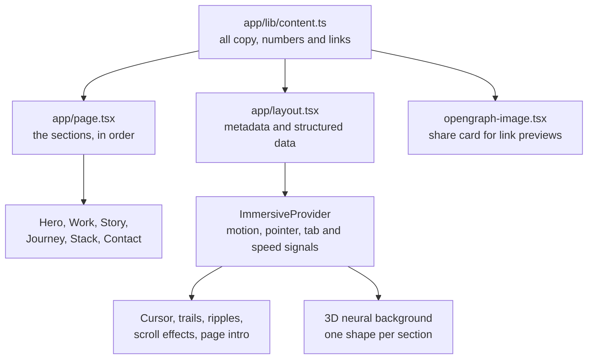

<div align="center">

# 🧭 Sagar Jain · Portfolio

**I turn ideas into things people actually use. This is the site that tells the story.**

[](https://nextjs.org)
[](https://react.dev)
[](https://www.typescriptlang.org)
[](https://tailwindcss.com)

[🌐 Live site](https://www.mrsagarjain.com) · [📝 Content](app/lib/content.ts) · [🧱 Components](app/components) · [🧪 Effects spec](.kiro/specs/immersive-experience)

</div>

---

## ✨ What is on the page

| Section | Anchor | What it shows |
| :-- | :-- | :-- |
| **Hero** | `#hero` | Headline, the headline numbers, the two roles held today and a live clock in India |
| **Work** | `#work` | valocoach.ai on web and phone, where it runs, a dated stats snapshot, and NeuroWRT |
| **Story** | `#story` | Five milestones from Iron 2 to the platform vision |
| **Journey** | `#journey` | Career timeline, from router firmware to AI products |
| **Stack** | `#stack` | About, tech stack, credentials and GitHub activity |
| **Contact** | `#contact` | Email and social links |

A small badge in the header climbs from **Iron 2** to **Immortal 1** as you scroll. The math is in [`app/lib/rank.ts`](app/lib/rank.ts).

## 🧩 How it fits together



## ✏️ Change the content

Everything visitors read lives in one file, [`app/lib/content.ts`](app/lib/content.ts). Components never type a number themselves.

| To change | Edit in `app/lib/content.ts` |
| :-- | :-- |
| Users, impressions, downloads, coaches | `metrics` |
| Hero text and the roles held today | `hero`, `now` |
| A career entry | `journey.entries` |
| About text, tech stack, credentials | `about`, `stack`, `credentials` |
| App, GitHub and social links | `links` |
| Search and share-card text | `seo` |
| A product screenshot | drop the file in [`public/work`](public/work), then list it in `showcase` (or `neurowrt.image`) |

> [!NOTE]
> The share card used for link previews is generated at build time from `app/lib/content.ts` (see [`app/opengraph-image.tsx`](app/opengraph-image.tsx) and [`app/twitter-image.tsx`](app/twitter-image.tsx)), so the numbers on it always match the site.

> [!IMPORTANT]
> The web screenshot and the stats snapshot in the Work section are dated (`snapshotDate`). They are real numbers read from the public stats page. When you replace the screenshot, refresh the snapshot rows in `coachSnapshot` and the date together.

## 🚀 Run it

You need Node.js 20.9 or newer (a Next.js 16 requirement).

```bash
npm install
npm run dev
```

Then open <http://localhost:3000>.

| Command | What it does |
| :-- | :-- |
| `npm run dev` | Development server |
| `npm run build` | Production build |
| `npm start` | Serve the production build |
| `npm run lint` | ESLint |
| `npm test` | Tests in watch mode |
| `npm run test:run` | Tests once |

## ♿ Motion and accessibility

- Honors the system reduced-motion setting. The **Motion on / off** switch in the corner overrides it for the page.
- Decorative layers are hidden from assistive technology, never take focus and never block clicks.
- Heavy effects switch off on touch devices, in hidden tabs and when the device cannot keep up.
- Every image has a description, and the stats snapshot is real text, not a picture.

## 🗂️ Project layout

```text
.
├── app/
│   ├── components/            Sections, effects and small building blocks
│   │   └── immersive/         Motion, pointer and speed coordination layer
│   ├── hooks/                 Shared hooks for that layer
│   ├── lib/
│   │   ├── content.ts         All copy, numbers and links (edit this first)
│   │   ├── rank.ts            Rank-up meter math
│   │   ├── shareCard.tsx      Share-card image, built from content.ts
│   │   └── immersive/         Pure logic for the effects, with property tests
│   ├── layout.tsx             Metadata, structured data and global effects
│   ├── page.tsx               The page, section by section
│   ├── opengraph-image.tsx    Share image for link previews
│   └── twitter-image.tsx      The same image for X
├── public/
│   ├── headshot.jpg           Hero photo
│   └── work/                  Product screenshots
└── .kiro/specs/               Requirements, design and tasks for the effects layer
```

<details>
<summary><b>Effects layer reference</b></summary>

<br/>

[`ImmersiveProvider`](app/components/immersive/ImmersiveProvider.tsx) owns four live signals that every animated component reads: whether motion is on, pointer type, tab visibility and a performance tier. It also runs one shared pointer listener and one shared frame loop, so dozens of effects do not each add their own.

[`PerformanceGovernor`](app/components/immersive/PerformanceGovernor.tsx) watches frame times and steps the effects down when the page drops below its budget.

The pure logic (scroll math, pointer limits, tiers, the rank ladder) lives in [`app/lib`](app/lib) and is covered by property-based tests with fast-check. Component tests use Vitest and Testing Library. Requirements and design are in [`.kiro/specs/immersive-experience`](.kiro/specs/immersive-experience).

</details>

---

<sub>Badges load from shields.io.</sub>
